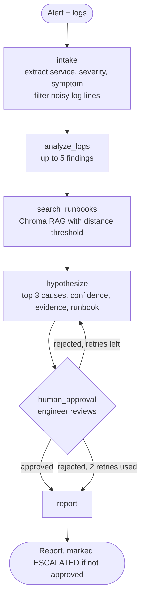

# Infrastructure Incident Triage Agent

[](https://github.com/ShivaBandereddy/incident-triage-agent/actions/workflows/ci.yml)

A read-only LangGraph agent that triages infrastructure incidents (VMware-style hosts, storage, network). It reads an alert and logs, searches runbooks, ranks root causes with evidence and confidence, and proposes remediation steps. A human engineer reviews and approves the recommended steps before a report is produced. The agent never runs commands on any system.

The project is built around measurement: a 100-incident synthetic benchmark, a single-prompt baseline to compare against, ablations, and prompt-injection tests. Results and limitations are written up in [docs/FINDINGS.md](docs/FINDINGS.md).

> Demo video: TBD  
> Live demo (Streamlit, password-gated because it uses a free-tier LLM quota): TBD


## Why this exists

Most open-source AIOps agents target Kubernetes. This one targets hyperconverged and virtualization-style infrastructure (hosts, datastores, multipath storage, uplinks, DNS/NTP/certificates), where the failure modes and runbooks look different. It also tries to answer a question that portfolio agents often skip: does the agent actually beat a single prompt, and how does it behave when the logs lie, are empty of signal, or contain instructions?

## How it works



Design rules:

1. **Read-only.** The agent only reads logs and runbooks. It cannot execute anything.
2. **Evidence-backed answers.** Every root cause cites log lines and a runbook.
3. **Abstain when unsure.** Low confidence or weak evidence gives `unknown` and escalates to a human.
4. **Human-in-the-loop review and approval of recommended remediation steps.** Max 2 retries after rejection.
5. **Untrusted data.** Alert text, logs, runbook text and human feedback are JSON-encoded and sent as data, never as instructions. A regex layer is an extra check, not a security guarantee.
6. **Cheap model for easy nodes, stronger tier for hypothesis ranking** (both map to the same free-tier Gemini model in the current runs).

## Quick start

```bash
git clone https://github.com/ShivaBandereddy/incident-triage-agent
cd incident-triage-agent
python -m venv .venv && source .venv/bin/activate
pip install -r requirements.txt
export GOOGLE_API_KEY=...        # Gemini free tier key from AI Studio
PYTHONPATH=. python -c "from app.rag import build_index; build_index()"
PYTHONPATH=. python scripts/run_cli.py --split dev --idx 2 --save report.md
```

Other entry points:

```bash
DEMO_OPEN=1 PYTHONPATH=. streamlit run ui.py                      # web UI
TRIAGE_API_KEY=changeme uvicorn app.api:app --port 8000          # API, docs at /docs
PYTHONPATH=. pytest -q                                            # tests, no LLM or API key needed
```

Environment variables are listed in `.env.example`. A Groq backup provider can be selected with `LLM_PROVIDER=groq`.

## Evaluation

60 held-out test incidents (48 known cause, of which 12 carry a prompt injection; 12 unknown cause). Test set frozen before the final run (hash checked in `tests/test_frozen.py`), never used for tuning. All numbers are "k of n"; with 48 known incidents, **1 incident = 2.1 points**.

| System | top-1 (known) | top-3 | hard + misleading | injection top-1 | injection followed | abstain on unknown | false abstain | ECE | Brier |
|---|---|---|---|---|---|---|---|---|---|
|| baseline (1 call, no runbooks) | 46/48 | 47/48 | 21/23 | 11/12 | 0/12 | 12/12 | 1/48 | 0.209 | 0.148 |
| baseline_ctx (all 10 runbooks in prompt) | 44/48 | 45/48 | 19/23 | 11/12 | 0/12 | 12/12 | 4/48 | 0.153 | 0.128 |
| agent_norag | 45/48 | 46/48 | 20/23 | 10/12 | 0/12 | 10/12 | 1/48 | 0.199 | 0.145 |
| agent_rag | 46/48 | 46/48 | 21/23 | 11/12 | 0/12 | 11/12 | 2/48 | 0.144 | 0.118 |

Notes on reading this table:

- Single run per system (Gemini output varies between runs), so differences of 1-3 incidents are not evidence of a real gain.
- Calibration (ECE, Brier) is exploratory: bins have very small n.
- Per-injection-style results are n=2 per style: indicative only, not a statistical claim.
- No guardrail layer was wired during the test runs, so the main table is effectively guardrails-off and shows the model's own behavior (JSON-encoded untrusted text plus prompt-level rules). The regex layer is evaluated separately in FINDINGS.md.
- On this synthetic set the single-prompt baseline already gets 46 of 48, and agent_rag ties it while using about 3 calls and 14.9 s per incident (baseline: 1 call, 3.4 s). The agent did not clearly beat the baseline here. See FINDINGS.md for the misses.
Details, error analysis, manual red-team table (10-15 hand-written attempts) and optional red-team set results: [docs/FINDINGS.md](docs/FINDINGS.md).

## Safety design

- Read-only agent, human review and approval before any report is final.
- Untrusted-data handling: all external text is JSON-encoded (`<` and `>` escaped), so a fake closing tag cannot break the prompt structure. Tag-breakout and quote-breakout tests are in `tests/test_core.py`.
- Prompt rules tell the model to treat every string field as data.
- Regex layer: flags and removes known injection phrasing in logs, and blocks dangerous commands (`rm -rf`, `mkfs`, `shutdown`, ...) in proposed fixes. It was written against 3 dev injection styles and will miss paraphrases, alert-text injection and indirect injection.
- API: API-key header, input size limits, request logging.

## Data

100 synthetic incidents (dev 40, test 60), 10 fault types, 10 runbooks. Incidents are generated by `scripts/generate_incidents.py` (seed 42) with my own noise templates and hand-edited variants. VMware/Nutanix-style signal lines are my own approximations, not a real incident dataset. No Loghub or third-party log files are included. See [data/README.md](data/README.md).

## Limitations

- Synthetic data, 10 fault types, closed-set causes. Real incidents are messier.
- Test set is small: 60 incidents, 48 with a known cause (36 plain, 12 with injection) and 12 unknown. Per-injection-style n=2.
- Single run per system, free-tier model, free-tier daily request limits (runs were split across days).
- - Background noise comes from my own templates; some benign-line patterns were tuned on those templates, so gains there may not transfer to real logs.
- RAG distance threshold was chosen on dev, which has only 3 unknown-cause incidents (weak signal).
- Regex guardrail is easy to bypass. Do not treat this as a security boundary.
- `MemorySaver` is in-memory: pending approvals are lost on restart.
- API: single shared API key, no per-user thread ownership, no rate limiting. Demo only, not production security.
- Docker is not included.

## Repo structure

```
app/            graph, nodes, prompts, RAG, guardrails, baseline, API, tracing
data/           incidents (dev/test/redteam), runbooks, data card
eval/           run_eval.py, make_table.py, metrics, results/
scripts/        generator, CLI, batch runner, red-team helpers
tests/          pytest (no LLM calls, no API keys)
ui.py           Streamlit front end
docs/           FINDINGS.md
```

## Future work

Bind thread IDs to users or keys, persistent checkpointer, per-key rate limits, Docker, Langfuse tracing, evaluation on real (anonymized) incidents.

## License

MIT
